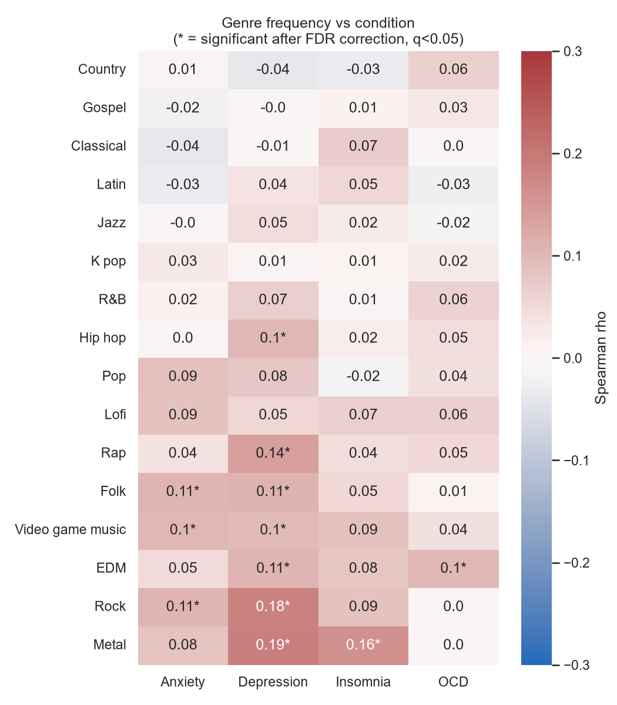
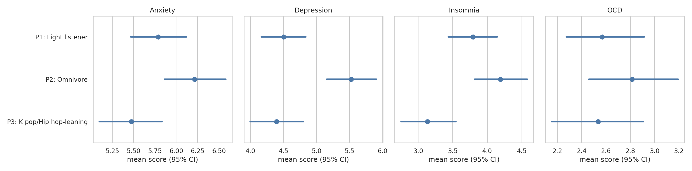
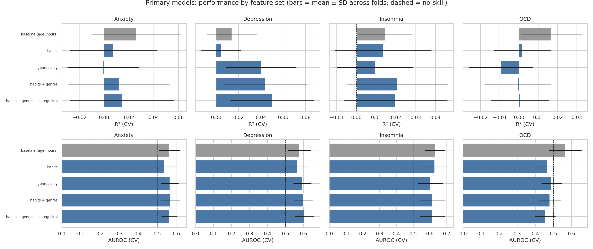
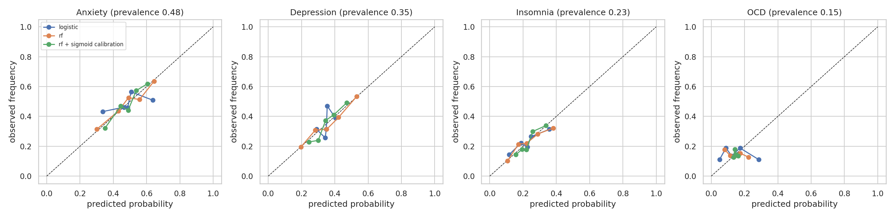

<<<<<<< HEAD
# Music & Mental Health: association analysis and research-grade prediction

An in-depth, fully reproducible analysis of the *Music & Mental Health* survey (736 respondents): which music genres and listening habits are associated with self-reported **anxiety, depression, insomnia and OCD**, how much of that is predictable, and which hypotheses deserve a controlled follow-up study.

> **Important.** This is associational analysis of self-reported, cross-sectional survey data. It is **not** a diagnostic or screening tool, and it makes no causal claims.

## Headline findings

| Question | Result |
|---|---|
| Genre-condition associations (Spearman, FDR-corrected) | 12 of 64 pairs significant, all positive and small (max rho = 0.19: Metal and Rock with depression, Metal with insomnia) |
| After adjusting for age, hours, instrument playing and other genres | No pair survives FDR; 4 stay nominally significant with consistent sign **and** stable predictive importance (Tier A below) |
| Listener personas (k-means, k = 3, bootstrap stability ARI = 0.82) | *Light listener* (n = 302), *Omnivore* (n = 233), *K pop/Hip hop-leaning* (n = 201). Omnivores report higher depression (about 5.5 vs 4.4) and differ significantly on depression, insomnia and anxiety after controlling for age and hours, but effects are small (epsilon-squared <= 0.024). No difference for OCD. |
| Prediction on the 148-person hold-out set | **Not distinguishable from chance.** AUROC for "high" (>= 7) is 0.49-0.57 and R² is -0.02 to 0.03, all CIs include no-skill. Music features add no significant predictive value over age and listening hours after FDR correction. |
| Calibration | Logistic probabilities are no better than predicting the prevalence (Brier skill about 0); calibrated random forest reaches at most 0.05 |
| Subgroups (age, hours, instrument) | AUROC about 0.5-0.6 everywhere; no subgroup where the model clearly works |

**What this means.** Music habits alone do not predict self-reported mental-health scores in a way that is useful at the individual level. The project's value is in the *effect sizes with uncertainty* and in a transparent triage of hypotheses for further research.

### Hypotheses worth testing (Tier A: significant raw association, adjusted association with same sign, stable permutation importance)

| Genre | Condition | Spearman rho (95% CI) | Direction |
|---|---|---|---|
| Rock | Depression | 0.18 (0.11, 0.26) | more listening, higher score |
| Metal | Insomnia | 0.16 (0.09, 0.23) | more listening, higher score |
| Folk | Anxiety | 0.11 (0.04, 0.18) | more listening, higher score |
| EDM | OCD | 0.10 (0.03, 0.17) | more listening, higher score |

Five further Tier B and thirteen Tier C pairs are in [`reports/tables/hypothesis_ranking.csv`](reports/tables/hypothesis_ranking.csv). Reverse causation (people with lower mood choosing certain music) is at least as plausible as an effect of the music.

## Figures

| | |
|---|---|
|  |  |
|  |  |

## Repository layout

```
.
├── data/
│   ├── raw/mxmh_survey_results.csv      # original survey (see data note)
│   └── processed/mxmh_clean.csv         # produced by notebook 01
├── notebooks/
│   ├── 01_cleaning_eda.ipynb            # audit, cleaning, EDA, genre effects, adjusted models
│   └── 02_personas_and_modeling.ipynb   # PCA, personas, CV models, hold-out, calibration, SHAP, hypothesis triage
├── src/mxmh/                            # config, cleaning, features/pipelines, modelling utilities
├── tests/                               # pytest unit tests for cleaning and statistics
├── scripts/run_pipeline.py              # runs both notebooks in order
├── reports/{figures,tables}/            # all generated outputs
├── docs/                                # data dictionary and methodology
└── .github/workflows/ci.yml             # runs the tests on every push
```

## Quick start

```bash
git clone https://github.com/<your-username>/music-mental-health-ml.git
cd music-mental-health-ml
python -m venv .venv && source .venv/bin/activate     # Windows: .venv\Scripts\activate
pip install -r requirements.txt
python -m pytest -q                                   # sanity checks
python scripts/run_pipeline.py                        # re-creates every table and figure (about 6 min on 1 CPU)
```

Or open the notebooks in Jupyter and run them in order (01 before 02).

## Methodology in brief

Spearman associations with bootstrap CIs and Benjamini-Hochberg FDR; HC3-robust OLS adjusting for confounders; k-means personas validated by bootstrap stability; 5x2 repeated CV with identical folds and the Nadeau-Bengio corrected t-test; a 20% hold-out touched once; calibration and subgroup checks; permutation importance stability across folds; SHAP for direction. All leakage controls and limitations are in [`docs/methodology.md`](docs/methodology.md). Column definitions are in [`docs/data_dictionary.md`](docs/data_dictionary.md).

## Limitations

- Single-item self-ratings, not validated clinical instruments (PHQ-9, GAD-7, ISI, OCI-R).
- Cross-sectional and self-selected online sample: no causal or temporal conclusions, limited generalisability.
- n = 736 limits power for small effects; rare genres (Gospel, Latin, Lofi) are too small to interpret.
- 153 respondents are under 18; subgroup results are descriptive only.

## Suggested follow-up research

1. Pre-register the Tier A/B hypotheses and test them in a new sample with validated clinical scales.
2. Use longitudinal or experimental designs to address direction of effect.
3. Capture listening *context and motivation* (e.g. coping, mood regulation), which this survey lacks.

## Data note

`data/raw/mxmh_survey_results.csv` is a public online survey dataset. Before publishing the repository, confirm the licence and attribution requirements of the original source and add them here (or delete the raw file and document where to download it).

## Licence

Code: MIT (see `LICENSE`).
=======
# Music-Mental-Health-Correlation
>>>>>>> fa9a6d1a2356d87c79ffbfd4a80ee1292889c541
